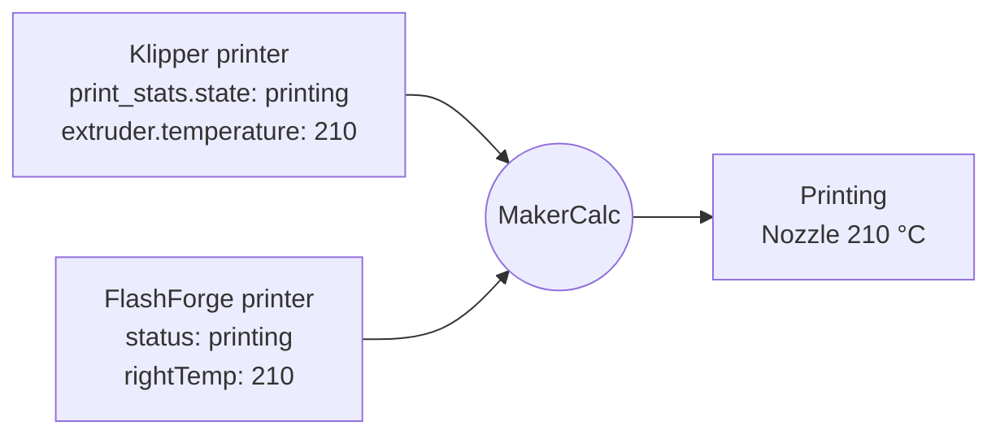
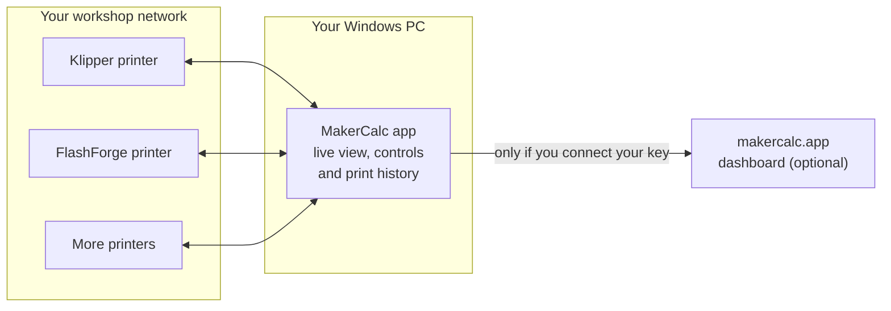
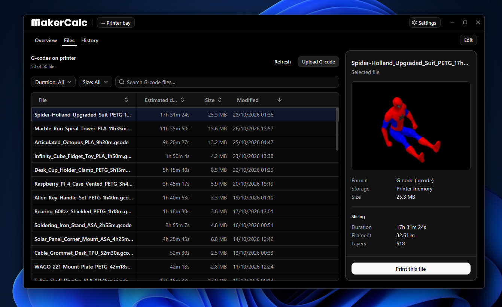
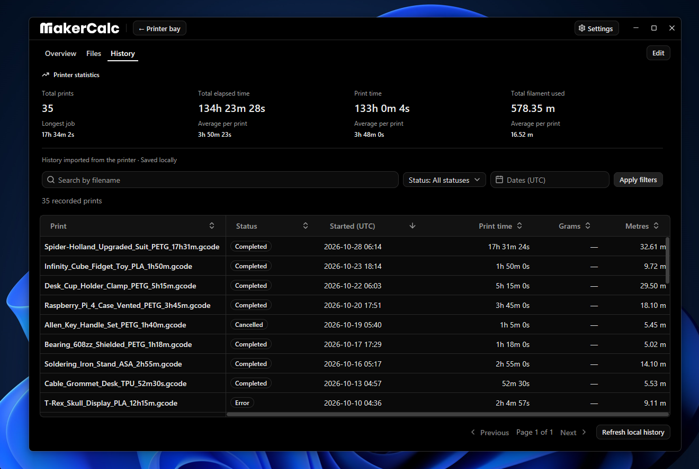
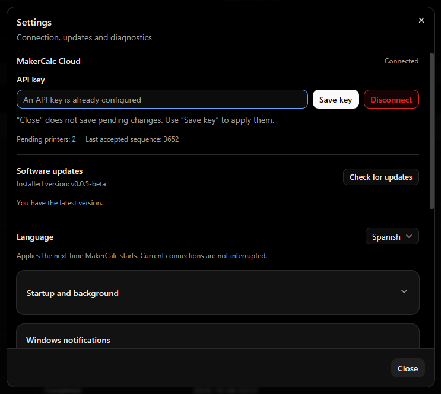

<p align="center">
  <picture>
    <source media="(prefers-color-scheme: dark)" srcset="docs/assets/makercalc_wordmark_white.svg">
    <source media="(prefers-color-scheme: light)" srcset="docs/assets/makercalc_wordmark_black.svg">
    
  </picture>
</p>

<p align="center">
  <strong>Your 3D printers, connected in one place.</strong><br>
  A Windows app that finds the printers on your network, understands each one<br>
  and shows them all side by side, live.
</p>

<p align="center">
  <a href="https://github.com/kkkohdeh/MakerCalcApp/releases/latest"></a>
  
  
</p>

<p align="center">
  <a href="#download">Download</a> ·
  <a href="#how-it-works">How it works</a> ·
  <a href="#what-you-can-do">Features</a> ·
  <a href="#connect-to-makercalc-on-the-web">Connect to the web</a> ·
  <a href="#questions">Questions</a>
</p>

---

## Download

<p>
  <a href="https://github.com/kkkohdeh/MakerCalcApp/releases/latest/download/MakerCalc-Setup.exe"></a>
</p>

Windows 10 (version 1903 or later) or Windows 11, 64-bit. Release notes for every version are on the [Releases](https://github.com/kkkohdeh/MakerCalcApp/releases) page.

Works today with **Klipper** printers (through Moonraker) and **FlashForge Adventurer 5M, 5M Pro and AD5X** on your local network.

## How it works

### One language for every printer

Every brand reports the same thing in its own way. MakerCalc translates each printer into one common language, so a Klipper machine and a FlashForge machine look the same in the app.



A few more examples of the same idea:

| What you see | Klipper reports | FlashForge reports |
|---|---|---|
| Progress **42 %** | `virtual_sdcard.progress: 0.42` | `printProgress: 0.42` |
| Bed **60 °C** | `heater_bed.temperature: 60` | `platTemp: 60` |
| Time left **30 min** | *not reported* → no estimate shown | `estimatedTime: 1800` |

MakerCalc never makes numbers up. If a printer doesn't report something, you see it as unavailable instead of a guess or a zero.

### Your printers, your PC, your dashboard



The app talks to your printers directly over your local network. It works on its own, and you can also connect it to [makercalc.app](https://makercalc.app/en) to see your printers from anywhere.

### From file to finished print


## What you can do

<p align="center">
  
</p>

- **Find printers** on your network automatically, search by IP, or add them by hand.
- **See everything live:** status, progress, temperatures, fans, filament and camera, in cards that adapt to each printer.
- **Control prints:** pause, resume and cancel.
- **Send files:** browse the G-code stored on each printer, drag and drop new files and start a print.
- **Manage filament:** load and unload it, and set its material and color, on printers that support it.
- **Look back:** print history for each printer and for all of them, with search, filters and sorting.
- **Stay informed:** Windows notifications when a print finishes, fails or loses connection. Turn them on in Settings.
- **Run in the background:** start with Windows and stay in the tray next to the clock. Both are optional, in Settings.
- **Your language:** English and Spanish.

<p align="center">
  
</p>

## Install

1. Download [`MakerCalc-Setup.exe`](https://github.com/kkkohdeh/MakerCalcApp/releases/latest/download/MakerCalc-Setup.exe).
2. Run it. It installs for your user only and doesn't ask for administrator rights.
3. The installer isn't digitally signed yet, so Windows may show *"Windows protected your PC"*. Click **More info → Run anyway**. Only download MakerCalc from this page.

<details>
<summary>Check that your download is intact (optional)</summary>

Every release includes `checksums.sha256`. In PowerShell, from the folder where you saved the installer:

```powershell
Get-FileHash .\MakerCalc-Setup.exe -Algorithm SHA256
```

The result must match the `MakerCalc-Setup.exe` line in `checksums.sha256`.

</details>

### Updating

MakerCalc tells you when a new version is out, and you can check anytime in **Settings → Software updates**. To update, download the new installer and run it. Your printers, keys and history are kept. Nothing is downloaded or installed without you.

## Connect to MakerCalc on the web

1. Sign in at [makercalc.app](https://makercalc.app/en) and open **Printers**.
2. Click **API keys** (the key icon), then **Create key** (or **Replace key** if you already have one) and copy it. The full key is only shown once.
3. In the app, open **Settings**, paste it into **API key** and click **Save key**.
4. Keep the app running on the workshop PC. To keep it in the tray when you close the window, turn on **Minimize on close** in Settings.

<p align="center">
  
</p>

Only the workshop owner can create keys, and one key can be active at a time. Live monitoring on the web depends on your [plan](https://makercalc.app/pricing/en).

## Your data

- **Stays on your PC:** printer passwords (encrypted by Windows), your local print history and the app logs.
- **Sent to your MakerCalc workshop, only after you connect a key:** printer names and status, the files being printed, print history and thumbnails. From the web you can also pause, resume or cancel prints.

## Questions

**Do I need the website to use the app?**
No. The app works on its own with the printers on your network. The website is optional.

**Does MakerCalc update by itself?**
No. It lets you know about new versions, and you choose when to install them.

**My printer isn't on the list.**
MakerCalc supports Klipper (Moonraker) and FlashForge Adventurer 5M, 5M Pro and AD5X today. If yours runs one of them and wasn't found, try **Search by IP** or add it by hand. Some printers don't announce themselves on the network.

**Something isn't working.**
[Open an issue](https://github.com/kkkohdeh/MakerCalcApp/issues) with your Windows version, your printer model and what happened. You can find the logs in **Settings → Diagnostics and logs → Open logs folder**.

---

<p align="center">
  MakerCalc is in beta: features may change between versions.<br>
  <a href="https://makercalc.app/en">makercalc.app</a>
</p>
